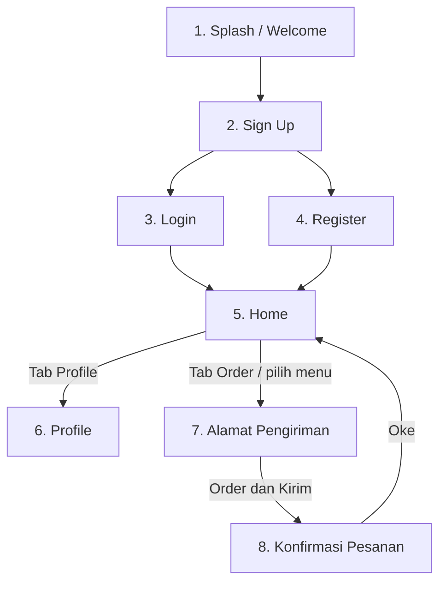

# ☕ Kopi dan Nyemil - Mobile App

Aplikasi Android pemesanan kopi dan camilan, dibangun dengan **Kotlin** dan **XML Views** (Material Components) di Android Studio. Proyek ini mengimplementasikan seluruh alur layar dari wireframe **Kopi dan Nyemil**. Data disimpan sementara di memori (*dummy data*), tanpa database.

---

## ✨ Fitur Utama

1. **Splash / Welcome**: Layar pembuka dengan logo, slogan *"Get a taste of your wish"*, dan tombol *Start now*.
2. **Sign Up**: Pilihan untuk masuk ke akun (*Login*) atau membuat akun baru (*Register*).
3. **Login User**: Masuk dengan *username* dan *password*. Akun demo: `budi` / `12345`. Username lain juga diterima dan akan dipakai sebagai nama sapaan.
4. **Register**: Membuat akun baru dengan nama lengkap, *username*, dan *password*. Data langsung tersimpan selama aplikasi berjalan.
5. **Home (Daftar Menu)**: Sapaan sesuai nama pengguna dan 6 menu kopi serta camilan dalam `RecyclerView`, lengkap dengan foto, deskripsi, dan harga. Klik item untuk memilihnya dan langsung lanjut ke tab Order.
6. **Profile**: Melihat dan mengubah nama pengguna. Perubahan langsung tampil di sapaan.
7. **Alamat Pengiriman (Order)**: Formulir nama penerima, alamat lengkap, dan patokan atau detail lokasi.
8. **Konfirmasi Pesanan**: Status pesanan berhasil, lalu kembali ke halaman Home.
9. **Bottom Navigation**: Pindah cepat antara **Home**, **Order**, dan **Profile**.

---

## 🧭 Alur Penggunaan Aplikasi



---

## 🥐 Daftar Menu (Dummy Data)

| No | Nama Menu | Kategori | Deskripsi | Harga |
| :-: | :--- | :--- | :--- | :--- |
| 1 | **Kopi Susu Gula Aren** | Minuman | Espresso, susu, gula aren | Rp 22.000 |
| 2 | **Donat Cokelat** | Makanan | Donat empuk, glaze cokelat | Rp 12.000 |
| 3 | **Sourdough Loaf** | Makanan | Roti fermentasi alami | Rp 35.000 |
| 4 | **Cappuccino** | Minuman | Espresso, foam susu lembut | Rp 25.000 |
| 5 | **Matcha Latte** | Minuman | Matcha Jepang, susu segar | Rp 27.000 |
| 6 | **Butter Croissant** | Makanan | Pastry renyah berlapis mentega Prancis | Rp 18.000 |

---

## 🛠️ Teknologi & Komponen

* **Bahasa**: Kotlin
* **UI**: XML Views dengan Material Components (tema terang)
* **Daftar Menu**: `RecyclerView` dengan `MenuAdapter`
* **Navigasi**: `BottomNavigationView` dengan satu Activity utama untuk tiga tab
* **Penyimpanan Data**: Objek statis `DataDummy` di memori (data kembali ke awal saat aplikasi ditutup)
* **Min SDK**: 24 (Android 7.0)
* **Package**: `lat.pam.kopidannyemil`

---

## 📂 Struktur Proyek

```text
app/src/main/
├── java/lat/pam/kopidannyemil/
│   ├── SplashActivity.kt        # Layar 1: Splash / Welcome
│   ├── SignUpActivity.kt        # Layar 2: Pilihan Login / Register
│   ├── LoginActivity.kt         # Layar 3: Form Login
│   ├── RegisterActivity.kt      # Layar 4: Form Registrasi
│   ├── MainActivity.kt          # Layar 5, 6, 7: Home, Order, Profile (Bottom Navigation)
│   ├── ConfirmationActivity.kt  # Layar 8: Konfirmasi Pesanan
│   ├── MenuAdapter.kt           # Adapter RecyclerView untuk daftar menu
│   ├── MenuItem.kt              # Model data satu item menu
│   └── DataDummy.kt             # Data statis: profil pengguna, pesanan, dan daftar menu
├── res/
│   ├── drawable/                # Foto menu, logo, dan ikon navigasi (ic_nav_*.xml)
│   ├── layout/                  # Layout XML tiap layar dan item_menu.xml
│   ├── menu/                    # Konfigurasi Bottom Navigation
│   ├── values/                  # Warna (colors.xml), teks (strings.xml), tema (themes.xml)
│   └── xml/                     # Aturan backup bawaan Android
└── AndroidManifest.xml

app/src/test/                    # Unit test untuk DataDummy
```

---

## 🚀 Cara Menjalankan Proyek

1. Clone repositori ini:

       git clone https://github.com/aabdlkarm/KopiDanNyemil.git

2. Buka **Android Studio**, pilih **Open**, lalu arahkan ke folder **KopiDanNyemil**.
3. Tunggu proses **Gradle Sync** selesai. Android Studio akan membuat `local.properties` secara otomatis.
4. Jalankan di perangkat Android fisik atau **Android Emulator**.
5. Klik **Run 'app'** (ikon segitiga hijau).

Untuk menjalankan unit test, pilih `app/src/test` lalu klik **Run Tests**, atau jalankan `./gradlew test` di terminal.

---

## 👤 Pengembang

* **Nama**: Abdul Karim
* **NIM**: 1247050017
* **Mata Kuliah**: Pengembangan Aplikasi Mobile
